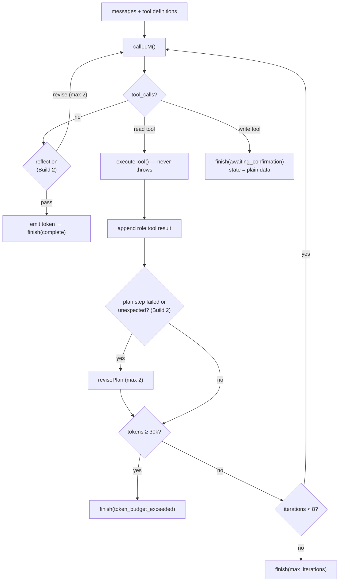

# Agent Loop — Build 1

**Code:** `backend/src/agent/agentRunner.js` (`runAgent`, `runLoop`, `resumeAgent`, `finish`)

The loop is hand-written. No LangChain, no `agent.run()`. Every exit path, cap and
pause point is in one file you can read top to bottom.

---

## The cycle



1. Send the conversation plus the tool definitions to the LLM (`callLLM`).
2. The model returns either `tool_calls` or a final answer.
3. For a tool call: run it, append a `role: "tool"` message matched by `tool_call_id`, and go back to step 1.
4. For a final answer: reflection grades it (Build 2), then it is streamed and the run ends.

Parallel tool calls (several in one response) are handled in order. Every call gets
exactly one tool message, because the provider rejects the next request if any call is
left unanswered.

## Hard limits

| Limit | Value | Where | Why this value |
|---|---|---|---|
| Iteration cap | **8** | `MAX_ITERATIONS` | The hardest case, "refund the duplicate and tell me why", needs getCustomer → getInvoices → checkRefundEligibility → issueRefund → answer. That is 5, and the extra 3 leave room for a retry after a tool error. |
| Token budget | **30,000 / request** | `MAX_TOTAL_TOKENS` | The iteration cap limits how *many* calls a run makes. This limits how *expensive* they get, since a few iterations with large tool results can burn a budget on their own. |
| Per-user budget | 20 req/min, 200k tokens/hour | `cache/rateLimit.js` (Redis) | Limits cost per caller across requests. It fails open if Redis is down, and the per-request caps above still hold. |

The budget is checked **after a full iteration**, never in the middle of one. Stopping
mid-iteration would leave tool calls unanswered and corrupt the conversation.

## Every exit is graceful

| Exit | `status` | `stoppedReason` | What the customer sees |
|---|---|---|---|
| Final answer | `complete` | — | The answer |
| Cap hit | `complete` | `max_iterations` | "I was unable to complete this request within my step limit. Let me hand this to a human colleague." |
| Budget hit | `complete` | `token_budget_exceeded` | "This request grew too large…" plus a human handoff |
| Write tool | `awaiting_confirmation` | — | Confirmation modal, or operator queue (Build 2) |
| LLM/provider failure | SSE `error` event | — | A true message (e.g. "usage limit reached"), never a useless "try again" (`describeFailure` in `server.js`) |

None of these throw at the caller. Each returns a usable reply **plus the full trace**,
so an operator can see what the agent was stuck on.

## Error recovery

- **Tool errors are data.** `executeTool` catches validation failures, unknown tools,
  bad JSON and handler exceptions, and returns `{error, message}`. The model reads that
  and retries with corrected arguments, tries another tool, or explains the problem.
  See [tool-design.md](tool-design.md).
- **Provider errors.** `llmClient.js` retries network errors with backoff. On a 429 it
  trips a 60-second circuit breaker and sends traffic to a Groq fallback chain of
  tool-calling models only.

## Persistence and observability

- `finish()` runs at **every** exit and calls `saveRun()`. The `AgentRun` document holds
  the full trace (per iteration: content, tokens, duration; per tool call: name, raw
  arguments, result, ok, duration), plus plan, reflections, route and status. Tool
  executions are also written to the `ToolCall` collection.
- **Correlation ID** is `runId` (`crypto.randomUUID()`). It is passed down through
  `executeTool → handler`, never stored at module level, so two concurrent requests
  cannot tag each other's records. Refunds and escalations carry it.
- **Structured logs** (`src/log.js`) write one JSON line per `llm_call`, `tool_exec`,
  `approval_resolved` and `run_end`, each with `runId`. To rebuild a run from logs alone:

  ```bash
  node src/server.js | grep '"runId":"<id>"'
  ```

- **Viewer:** `GET /runs/:runId` and the frontend's TraceViewer (expandable per iteration).

## The pause is data, not a suspended function

When a write tool is called, the loop returns a plain object: `messages`, `pending`
(tool, arguments, `remainingCalls`), `trace`, counters, `runId`, `callerId`, plan and
reflections. There are no closures. `resumeAgent(state, approved)` continues from that
object on any process, which is what Build 2's restart-survival relies on. See
[hitl-design.md](hitl-design.md).

## Demonstrations

| # | Demo | How |
|---|---|---|
| 1 | Iteration cap | `node tests/test-safety.js`. Part E replaces `getCustomer` with one that always returns a retryable `rate_limited` error. The model keeps retrying until the loop stops at 8 with `stoppedReason: max_iterations` and a handoff reply. |
| 3 | Tool error → recovery | `node tests/test-agent.js`. `getCustomer("ghost@nowhere.com")` returns `customer_not_found`, and the agent asks for the right email instead of crashing. |
