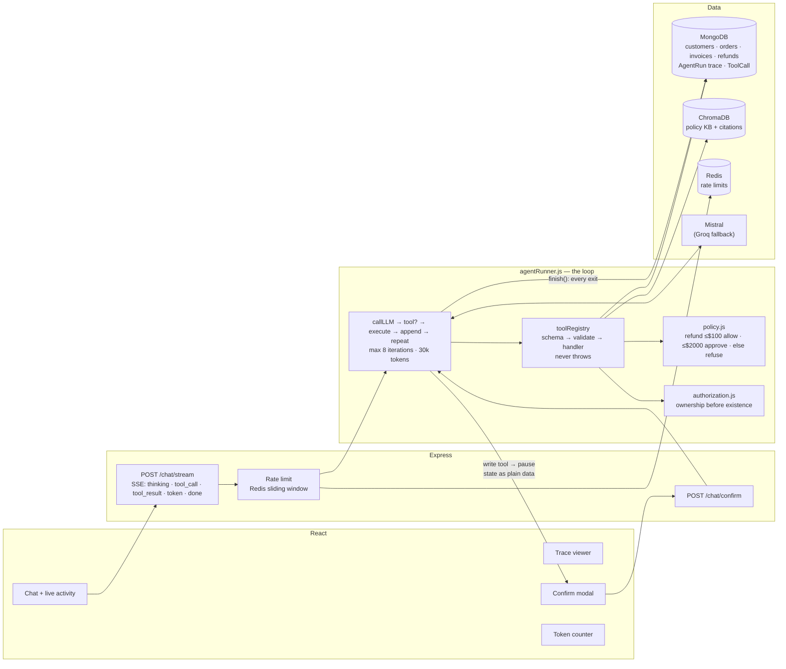

# Build 1 — Single agent with tool calling

**Key properties:** the loop owns every exit (answer, cap, budget, pause). Tool errors
come back as data. Limits live in `policy.js`, not the prompt. Each run is persisted
with a `runId` and logged as JSON lines.
