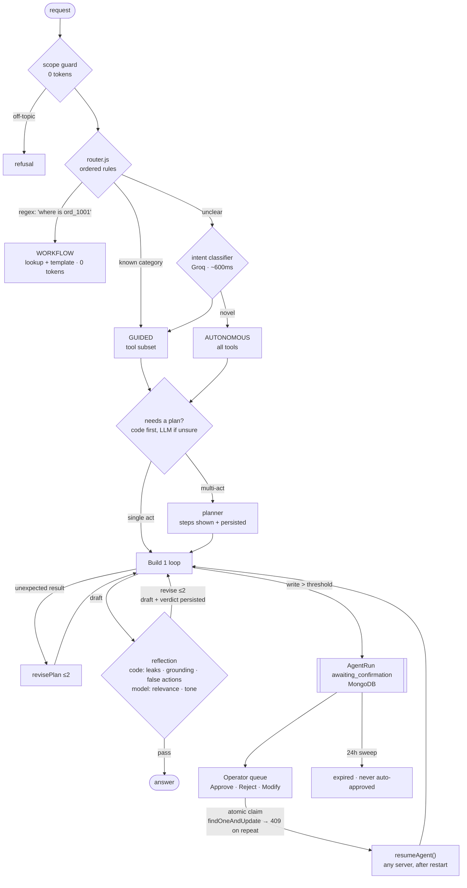

# Build 2 — Planning, reflection, human-in-the-loop, routing

**What lives where:** MongoDB has anything whose loss would cause wrong behavior
(paused runs, approvals, traces). Redis has hot, fine-to-lose counters (rate limits,
token budgets). The client holds the conversation, so the server is stateless between
turns. See [hitl-design.md](../hitl-design.md).
