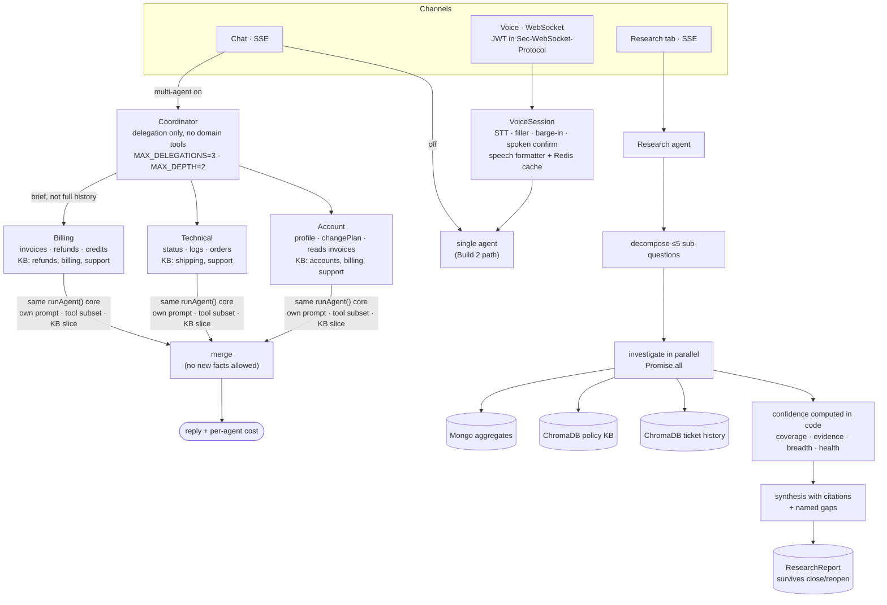

# Build 3 — Multi-agent, research agent, voice

**Isolation is the point:** a specialist never *sees* tools outside its subset, and the
KB is filtered by category in the Chroma query. Writes are isolated strictly and reads
loosely (see [multi-agent-analysis.md](../multi-agent-analysis.md)). Voice is a channel
over the same `runAgent()`, not a second implementation.
