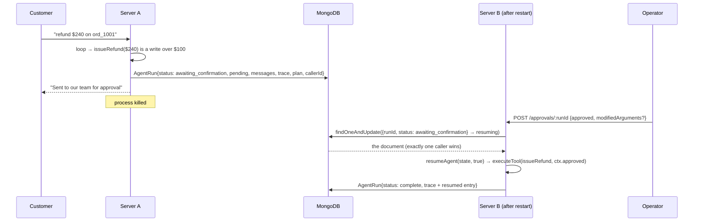

# Human-in-the-Loop Design — Build 2

**Code:** `backend/src/agent/approvals.js` · `resumeAgent()` in `agentRunner.js` · `POST /approvals/:runId` in `server.js` · `policy/policy.js`
**UI:** `frontend/src/OperatorQueue.jsx` (Approve / Reject / Modify) · `ConfirmModal.jsx`

---

## Approval tiers

The line is drawn on **reversibility, not size**. All tiers are enforced in code
(`checkRefundAmount`, `checkCreditAmount`, `describeToolCall`), never in the prompt.

| Condition | Behavior | Who decides |
|---|---|---|
| Read-only tools | Autonomous | — |
| Write ≤ threshold (refund ≤ $100, credit ≤ $50) | Executes after the **customer** confirms their own request; logged (`ToolCall` row, `approval_resolved` log line, trace) | Customer |
| Write over threshold ($100.01–$2,000 refund, ≤ $500 credit) | **Paused**: run persisted to MongoDB, item queued for an operator, customer told it is under review | Operator |
| Over the hard ceiling (> $2,000) | **Refused** in code (`policy_violation`) and escalated. Not approvable | Nobody in this system |
| Escalation triggers (legal, security, account deletion) | Always human: `escalateToHuman`. No deletion tool exists, and `LIMITS.neverAutonomous` blocks future ones | Human queue |

**Deviation from the brief, defended.** The brief has under-threshold writes run
"autonomous, logged". We kept a one-click **customer** confirmation for them. That is
not a staff approval: no operator is involved and nothing queues. It is consent from
the person the money goes to, and it catches the agent misreading which order or amount
was meant. It costs one click and no tokens. Removing it is a one-line change in the
loop's pause check (`isWriteTool(name)` → `isWriteTool(name) && summary.requiresOperator`).

## Pause → persist → resume (the hard part)



- **The pause is data, not a suspended function.** When a write tool is hit, the loop
  returns a plain object: `messages`, `pending` (tool, arguments, `remainingCalls`),
  `trace`, counters, `runId`, `callerId`, `plan`, `reflections`. There are no closures.
  `saveRun()` writes it, so any process can rebuild it from the document alone.
- **Resume** (`POST /approvals/:runId`) reloads the document and calls
  `resumeAgent(state, approved, {modifiedArguments, rejectionNote})`. The confirmed tool
  runs with the restored `callerId` (the authorization badge) and `approved: true` (the
  approval badge). The model gets the tool result and writes the customer-facing reply.
- **Batched calls survive.** If the model asked for refund + escalation in one turn,
  `remainingCalls` are executed in order after the confirmed one.

## What lives where (Redis vs MongoDB vs client)

| State | Lives in | Why there |
|---|---|---|
| Paused runs, approvals, traces, refunds | **MongoDB** | Losing it means wrong behavior: an approved refund that never happens, or one that happens twice. It has to survive restarts and be visible to every instance. The atomic claim needs a single source of truth |
| Rate-limit windows, hourly token budgets | **Redis** | Hot, written every request, fine to lose. Fails open (see `cache/redis.js`) and the per-request caps still hold |
| Speech-rewrite cache (voice) | **Redis** (+ in-process fallback) | Hot and shared across instances. Losing it costs one LLM call, never a wrong answer |
| Conversation history between turns | **Client** (sent back each turn, sanitized server-side) | The server stays stateless, so a restart mid-conversation loses nothing |

**Why the paused run is *not* in Redis**, even as a cache: a default Redis has no
persistence guarantee (eviction, restart without AOF). A paused approval that
disappears on eviction is exactly the "in-memory pause" the brief says fails the build.
A second copy would also need invalidating on every claim, release and expiry, and
that is how a double refund gets in. Reads of the queue are rare (an operator
clicking), so Mongo's latency is irrelevant here.

## Idempotent resumption

```js
AgentRun.findOneAndUpdate(
  { runId, status: "awaiting_confirmation" },   // the condition IS the lock
  { status: "resuming", claimedAt: new Date() },
)
```

`findOneAndUpdate` is atomic per document. A double-click, a retry, or two operators
at once: exactly one gets the document, and everyone else gets **409
`already_resolved`** ("It was not applied twice"). If the resume itself fails (provider
down), `releaseRun()` puts the run back in the queue instead of stranding it in
`resuming`. Test: `tests/test-hitl.js` parts D and E.

## Timeout: 24 hours, then expire, never auto-approve

| Option | Verdict |
|---|---|
| Auto-approve on timeout | **No.** "Nobody looked" is the weakest reason to move money, and it creates an attack: file at 5pm Friday and wait |
| Wait forever | The queue fills with stale items and the customer never hears back |
| **Expire** | **Chosen.** `APPROVAL_TTL_MS = 24h`. `startExpirySweep()` runs at boot and every 15 minutes, and marks stale runs `expired` with `expiredAt`. They leave the queue, and an approval click on one returns 409 |

**Known gap:** the expired run is not yet resumed as a rejection, so no reply is
generated for the customer. The reply path exists (expiry is the same shape as a
rejection: `resumeAgent(state, false, {rejectionNote: "No supervisor responded within
24 hours"})`), but there is no outbound channel (email) to deliver it on. Wire it up
when notifications exist.

## Operator queue: Approve / Reject / Modify

Each pending item shows the customer's request, the agent's reasoning (its last message
and the trace), the exact action as a sentence ("Refund $240.00 for order ord_1001",
irreversible warning) and the customer context.

- **Modify:** the operator edits the amount, and the run proceeds with the edited value
  *through the same `executeTool`*, so validation and policy run again. Raising $240 to
  $5,000 is refused by the same code. Approval changes **who asked**, never **what is
  allowed**.
- **Rejection doesn't crash the run.** The tool result becomes "declined by a human"
  (plus the operator's note), and the model tells the customer and offers an
  alternative. Test: `tests/test-hitl.js`, `tests/test-confirm.js`.

## Demonstrations

| # | Demo | How |
|---|---|---|
| 6 | Pause → **restart** → approve → resume | Live: in chat ask *"refund $240 on ord_1001 for the duplicate charge"* → item appears in Approvals → **Ctrl+C the backend, start it again** → click Approve → the trace shows the resumed refund, and `ord_1001.refundedAmount` changed. Scripted: `node tests/test-hitl.js` part C (only the `runId` string is carried over, everything else is re-read from Mongo) |
| 7 | Rejected → handled | Reject in the queue with a note. The run completes with a reply explaining the decision, and no refund row is written |
| — | Double-click | Click Approve twice quickly: the second gets 409 and there is one refund. `tests/test-hitl.js` part D |
