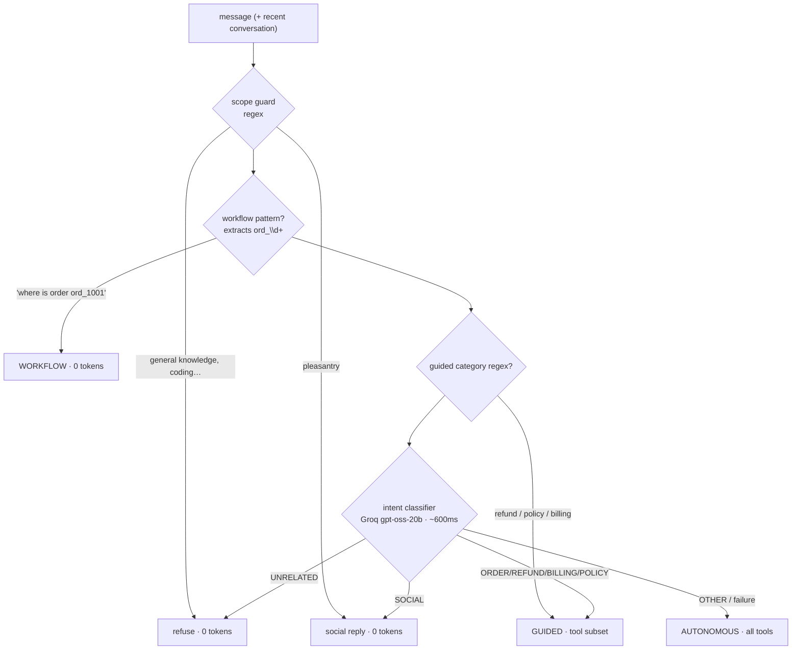

# Routing Strategy: Workflow vs Guided vs Autonomous — Build 2

**Code:** `backend/src/agent/router.js` (one ordered rule list) · `agent/intentClassifier.js` · `constants.js` (`ROUTES`, `WORKFLOWS`)
**Analytics:** `GET /routing` → Costs tab "Traffic split" bar and "Per route" table

---

## The point

Not every ticket needs an agent. An agent is the most expensive, slowest and least
predictable way to answer a question. It is the right tool only when the request needs
judgment the code can't supply. The router's job is to send every request to the
**cheapest path that can answer it correctly**.

## The three paths

| Route | When | What runs | Cost |
|---|---|---|---|
| **Deterministic workflow** | High volume, fully predictable, and *everything needed can be extracted by a regex* | DB lookup + template. **No LLM** | **0 tokens, ~12ms** |
| **Guided agent** | Known category, some judgment needed | The real loop with a **tool subset**. Tools not on the list are never shown to the model | ~5.3k tokens, 7.5s |
| **Autonomous agent** | Novel, ambiguous, or matches no known pattern | The loop with all 11 tools | ~8.0k tokens, 13.3s |

Plus two zero-cost exits in front: **out of scope** ("who is the PM of India?" → polite
refusal, 0 tokens) and **social** ("hi", "thanks" → a short reply, not a refusal).

## Decision order (cheap first)



## Why each category routes where it does

| Category | Route | Toolset | Why |
|---|---|---|---|
| Order status *with an order ID* ("where is ord_1001", "ord_1001?") | **workflow** | none | The answer is one lookup plus one sentence. A model adds latency, cost and the chance to invent a delivery date, and no judgment |
| Order status *without an ID* ("where's my stuff?") | guided `order` | getCustomer, getOrders, searchKnowledgeBase, escalateToHuman | Needs a lookup chain the regex can't plan, but nothing that moves money |
| Refunds, duplicate charges | guided `refund` | + getInvoices, checkRefundEligibility, issueRefund | Judgment needed (which charge is the duplicate), but the tool surface is known and bounded. No credits, no plan changes |
| Policy questions ("how long do refunds take?") | guided `policy` | searchKnowledgeBase, escalateToHuman | Answer must come from documents. Giving it account tools would only invite it to wander |
| Billing (invoices, credits, payments) | guided `billing` | getCustomer, getInvoices, getOrders, applyAccountCredit, … | Bounded write (credit ≤ $50 auto) |
| Anything else | **autonomous** | all 11 | Novel by definition. This is what the full agent is for |
| Off-topic | refuse | — | Before this guard it cost 3,905 tokens to *answer from model memory*, which is the exact thing the project forbids for policy |

**Failure direction:** if the classifier times out or errors, the request goes to
**autonomous**. That is slower and dearer, but still correct. A router outage must never
make the system wrong. A workflow that can't handle its input (unknown order ID) falls
through to the agent.

**Routing on the conversation, not just the last message.** When the customer is
*answering the agent's question* (an email address, "yes, the second one"),
`isAnswerToAQuestion()` keeps the turn with the ongoing agent conversation instead of
routing the fragment on its own. Refusals still run **first**: a closing "anything
else?" from the agent once let an off-topic question slip through as an "answer".

## Traffic distribution (measured)

Across **278 real runs** (logged in `AgentRun.route`, from the `GET /routing` aggregation):

| Route | Share | Avg tokens | Avg latency |
|---|---|---|---|
| workflow | 16.9% | **0** | **12ms** |
| guided | 43.2% | 5,286 | 7.5s |
| specialist (Build 3) | 30.2% | 6,543 | 8.4s |
| autonomous | **9.7%** | 7,989 | 13.3s |

**Only 9.7% of traffic needed the full autonomous agent.** Without the router, every
request would pay autonomous cost: ~8.0k tokens and 13.3s. With it, ~1 in 6 requests
costs nothing and returns in 12ms, and most of the rest run with a smaller, safer
toolbox.

**Caveat, stated plainly:** these runs came from development and test traffic (the
benchmark suites plus manual use), not production. The workflow share is what you'd
expect to grow with real "where is my order" volume. The number to re-measure in
production is the autonomous share.

Re-measure any time: open the Costs tab, or

```bash
curl localhost:5000/routing
```

## Demonstration 8: routed to a workflow instead of the agent

Ask *"where is order ord_1001?"*. The activity feed shows `routed workflow / order_status`,
the trace shows iteration 0 with **0 tokens** and ~12ms, and the run's `run_end` log
line says `"route":"workflow","tokensUsed":0`. Tests: `node tests/test-routing.js`,
`node tests/test-router-patterns.js` (runs in CI, no LLM).
