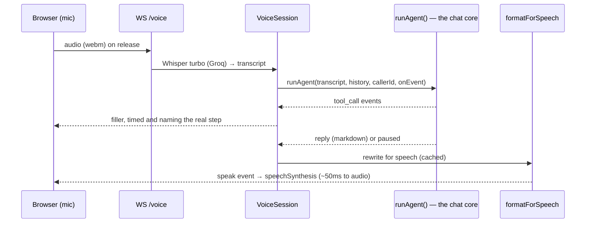

# Voice Design — Build 3

**Code:** `backend/src/voice/voiceServer.js` (WebSocket, auth) · `voiceSession.js` (turns, filler, barge-in, HITL) · `speechFormat.js` (speech formatter + cache) · `stt.js` · `backend/src/auth/jwt.js`
**UI:** `frontend/src/VoiceCall.jsx` (waveform, live transcript, agent-activity indicator)

---

## Same core, different formatter

Voice calls the **same `runAgent()` / `resumeAgent()`** as chat, with the same router,
policy, approvals, reflection and trace. Nothing in the agent knows it is on a call.
The voice layer adds five things: STT, a speech formatter, a filler clock, barge-in,
and a spoken confirmation.

## Latency: where the time goes

| Segment | Typical | Note |
|---|---|---|
| Release → transcript | ~0.3–0.6s | `whisper-large-v3-turbo`. On a phone call, latency is accuracy |
| Text → first audio | **~50ms** | In-browser `speechSynthesis`: no audio crosses the network, so speech starts the instant text arrives |
| Agent work (guided / autonomous) | 7.5s / 13.3s avg | Covered by the filler (below) |
| Workflow answers | ~12ms | Answer arrives before the filler would fire |

**"Sub-second time-to-first-audio"**: synthesis is sub-second by a wide margin. From the
moment the caller stops talking, the first audio is either the answer (fast routes) or
the first filler at **1.2s** (`FILLER_DELAY_MS`). That 1.2s is deliberate: most fast
tools finish inside it, and announcing work you've already finished is worse than a
beat of silence. It is one constant. 700ms gets under a second at the cost of more
"let me check" on quick answers.

**Streaming both directions, honestly:** audio *out* streams sentence by sentence
(several `speak` events per turn: filler, confirmation, answer). Audio *in* is
push-to-talk: one utterance per send, because Whisper over HTTP transcribes whole
clips. Continuous streaming STT (a streaming ASR over the same socket) is the upgrade
if turn-taking needs to feel like a phone call rather than a walkie-talkie.

## Voice-specific problems

### 1. Responses must be rewritten for speech

A table is a map; speech is directions. `formatForSpeech()`:

1. `needsRewrite()` is free: does it have a table, ≥ 4 bullets, or > 30s of speech?
2. If not, a **mechanical pass** only (regex): `$240.00` → "240 dollars", `ord_1001` →
   "order 1 0 0 1", markdown stripped.
3. If so, **one LLM rewrite** with strict rules (never drop a number or ID, count first
   for long lists, ~60 words), then the mechanical pass again over its output.
4. If the rewrite fails, the mechanical pass is used. A call never fails because a
   formatter did.

### 2. Silence feels like a dropped call (filler)

- **Timed:** nothing for the first 1.2s, so fast tools finish silently.
- **True:** the filler names the step actually running (`getOrders` → "I'm looking up
  your orders now", `lookupLogs` → "Looking at what our systems recorded"). Generic
  "please hold" sounds like a recording.
- **Escalates:** "Still working on this…" every 6s, at most 3 fillers, then an honest
  "taking longer than it should, or I can have someone call you back".
- The clock runs from **when the caller stopped talking**, not per step. Progress the
  caller can't hear isn't progress.

### 3. HITL over voice

Two different approvals, two answers:

| Who must approve | Design |
|---|---|
| **The customer**, for their own small request (≤ $100 refund) | Speak the action with the irreversibility warning ("Refund 55 dollars for order 1 0 0 1. This cannot be undone. Shall I go ahead?") and accept a spoken yes or no. **Anything unclear means ask again, never assume yes**: a misheard mumble is not consent to move money. Same pause, same `resumeAgent()` |
| **A supervisor** (> $100) | **Don't hold the line.** Say what will happen, who decides and when they'll hear back, then end the call cleanly. The item is in the same operator queue as chat |

Why: holding a caller for a human who may be minutes away turns a 30-second call into a
6-minute one that ends in a hang-up. **Voice never lowers a limit.** A $500 refund needs
an operator whether it came from voice, chat or anything else.

### 4. Barge-in

The browser sends `barge_in` the moment the caller speaks. The server bumps a
generation counter, and any reply belonging to an older generation is **discarded,
not spoken**, including one still in the speech rewrite (it re-checks after the
rewrite). Barge-in works during the *silence*, not only mid-sentence, because that is
when people interrupt. We stop **speaking**, not **doing**: a run that may already have
moved money is allowed to finish and record its result.

## Backend requirements

- **WebSocket with the JWT in `Sec-WebSocket-Protocol`, never the URL.** The page calls
  `POST /voice/token` (a 60-second HS256 JWT, `src/auth/jwt.js`, no `alg: none`,
  constant-time signature compare), then `new WebSocket(url, ["helpdesk.v1", token])`.
  The server verifies it **during the handshake** (`verifyClient`): a bad or expired
  token gets **401** before a session exists. It answers with `helpdesk.v1` only and
  never echoes the token. `Authorization: Bearer <jwt>` is also accepted for
  server-side clients. URLs land in access logs, proxies, browser history and Referer
  headers; headers don't. Test: `tests/test-voice-auth.js` (runs in CI).
  *Identity behind the token is still the project's stand-in `x-caller-id`; real login
  only has to change who `POST /voice/token` signs for.*
- **TTS response caching for repeated phrases.** Synthesis is the browser's own and
  free, so there is no audio to cache. The cacheable, paid step is the **speech
  rewrite** (~1s, a few hundred tokens), and the same answer always produces the same
  spoken text. Cache: key `sha256(text)`, **Redis** with a 24h TTL (shared across
  instances), plus a 500-entry in-process fallback when Redis is down. A hit returns
  `cached: true, tokens: 0`. Fixed phrases (greeting, fillers, confirmation templates)
  are constants and never reach the model. Test: `tests/test-speech-cache.js`.
  *If you move to a cloud TTS (audio bytes), the same key/cache wraps the audio call.*

## Demonstration 11: voice call with a tool call and the silence handled

Voice tab → Start call → hold to talk: *"I'm alice@shop.com, show me my invoices"*.
The activity indicator shows `getCustomer`, `getInvoices`. After about 1.2s you hear
"Let me pull up your account." The answer is spoken as sentences ("You have three
invoices…"), never as a table. Talk over it to barge in: playback stops, and the
transcript shows `barge_in`. `node tests/test-voice.js` (server running) scripts a call
end to end.
